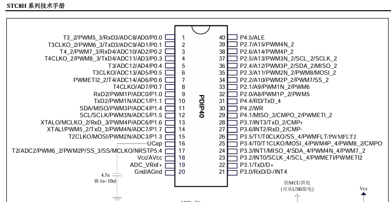
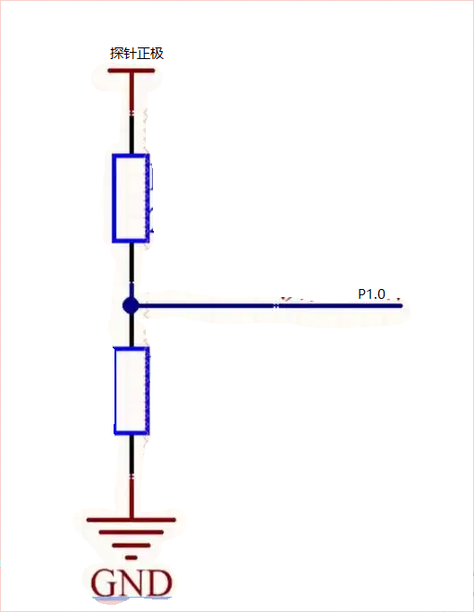
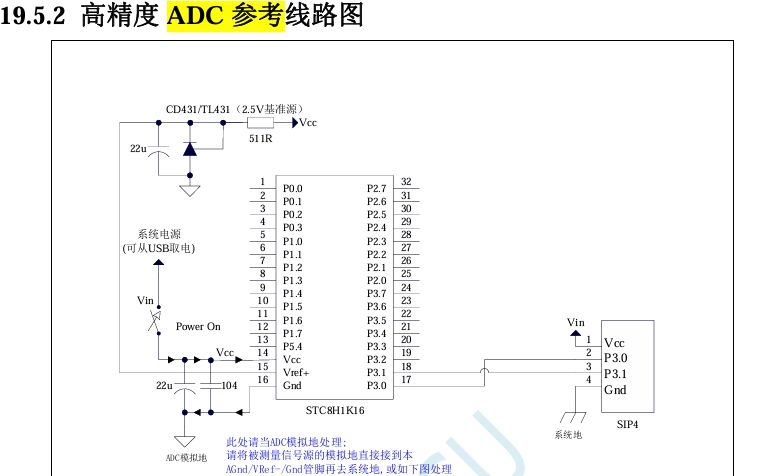
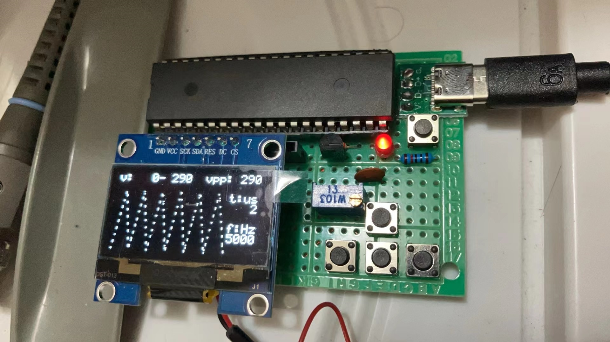
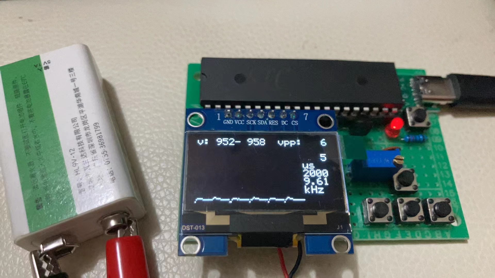
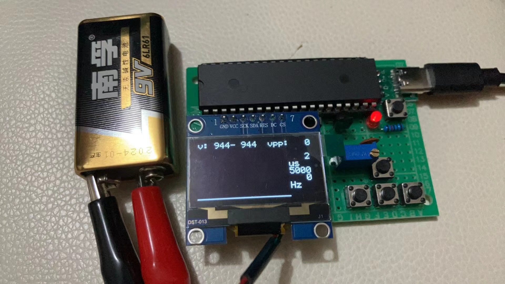
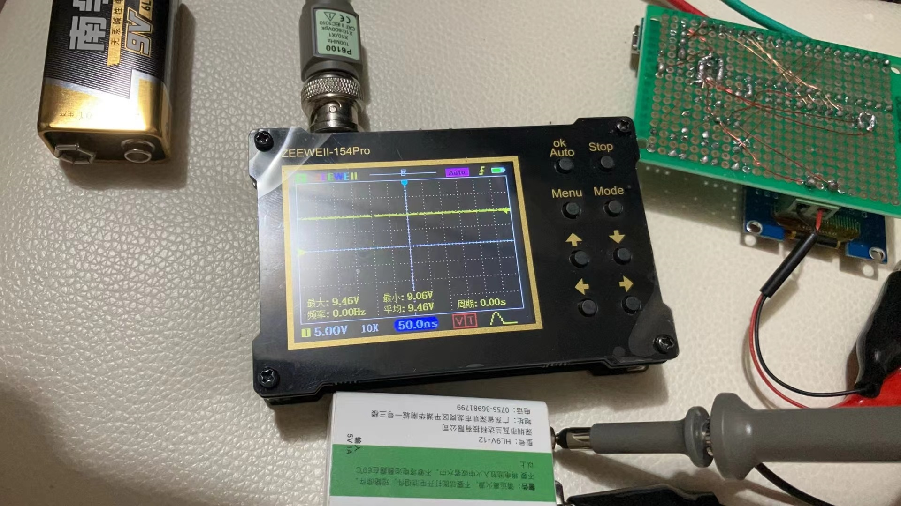

# stc8h8k64u_adc
项目直接使用keil4编译通过，兼容性极高。无需第三方工具添加头文件和扩展中断号。

### 参考官方文档和图形化aicube，写了一个最简单的stc8h8k64u adc示波器。
在最小系统的基础上，在vcc口串联了指示灯、电阻、按断开关（按下断电的开关）方便下载程序使用。VCC口和GND并联了220uF的电容提高电源稳定性，间接提高了采样精度。推荐使用外接锂电池等直流源作为电源。
下载时需要选择40Mhz，最大支持500K采样率，每点采样间隔可调节为2、5、10、20、50、100、500、1000、1600us。Y幅度自动调节，上p2.0是增加每个点采样间隔，下p2.1是减少，右p2.3是暂停一下看波形。
### 不太会计算波形呀，怎么能精确计算频率呢？

### 屏幕是sh1106，使用了硬件spi定义如下：
sbit OLED_SCL = P3^2;//SCL
sbit OLED_SDA = P3^4;//SDA
sbit OLED_RES = P3^6;//RES
sbit OLED_DC  = P3^7;//DC
sbit OLED_CS  = P3^5;//CS
### ADC参考电路如下：

ADC的分压电阻使用了一个10K的精密可调节电阻代替，需要旋转到一定比例，使得能测到最大电压是40.95v。比如测9.51v电池，adc测量在屏幕是显示为大约9510-9510。

### 以下是实物图：

### 有没有能完善一下的大佬，欢迎修改。
